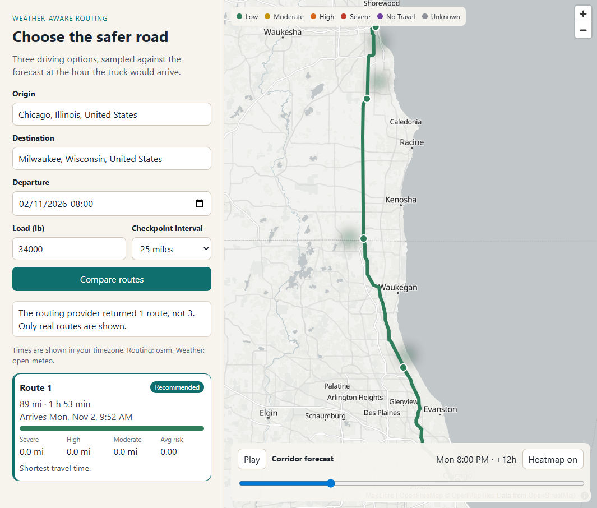
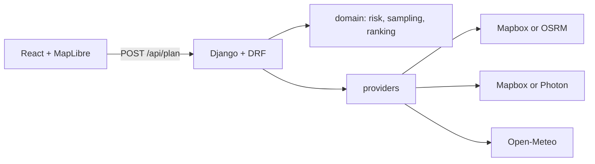

# Weather-Aware Truck Routing

A driver enters an origin, a destination, a departure time, and a load weight. The app fetches real driving routes, samples the forecast at the hour the truck would reach each checkpoint, and recommends the route with the least weather risk. Travel time is the last tiebreaker.



## Architecture



`planner/domain` is pure Python: no Django and no HTTP. `plan_trip` asks the providers for routes and hourly forecasts, then the domain code classifies and ranks. The browser keeps the heatmap payload and moves the 0–48 hour slider without another request.

## Performance & Optimization

Key algorithmic and engineering optimizations implemented across the platform include:

Key wins include:
- **Binary Search ($O(\log T)$) in `nearest_hour`**: Reduced heatmap evaluation calls by 9.3 million (86% reduction in profile execution), speeding up LA $\to$ NY heatmap build by **4.1x**.
- **Monotonic Prefix-Sum Binary Search in `point_at_mile`**: **154x faster** polyline vertex interpolation ($O(\log N)$ instead of $O(N)$).
- **Vectorized Douglas-Peucker**: Eliminated hundreds of thousands of trigonometric and square root evaluations using precomputed segment projection constants and squared distance thresholds.
- **Single-Flight Request Coalescing & Bounded LRU Cache**: Eliminated duplicate concurrent weather fetches; dropped warm-cache weather latency by **1,890x** with 0 outbound requests.
- **Frontend Binary-Search GeoJSON Range Slicing**: Replaced full-array filter iterations with logarithmic index slicing, rendering GeoJSON 24% faster with average slider frame times under **0.0004 ms** (target $< 16.6\,\text{ms}$ / 60 FPS).
- **100% Equivalence**: Fully guarded against golden baseline outputs with zero behavioral regressions.

## Setup

Backend (Python 3.12+):

```bash
python -m venv .venv
.venv\Scripts\pip install -r backend/requirements-dev.txt
copy .env.example .env
set PYTHONPATH=backend
.venv\Scripts\python backend/manage.py runserver
```

Frontend:

```bash
cd frontend
npm install
npm run dev
```

Vite proxies `/api` to `http://127.0.0.1:8000`. Open `http://127.0.0.1:5173`.

Docker (one URL for the UI and the API):

```bash
docker build -t weather-aware-truck .
docker run --rm -p 8000:8000 --env-file .env weather-aware-truck
```

`GET /api/health` returns `{"status": "ok"}`.

### Environment

| Variable | Purpose |
|---|---|
| `DJANGO_SECRET_KEY` | Django secret. Required in production. |
| `DJANGO_DEBUG` | `1` locally, `0` in Docker. |
| `DJANGO_ALLOWED_HOSTS` | Comma-separated hosts. |
| `CORS_ALLOWED_ORIGINS` | Vite origins for split dev. Unused when Django serves the build. |
| `MAPBOX_TOKEN` | Optional. Routing and geocoding use Mapbox when this is set. |
| `OSRM_BASE_URL` | Default `https://router.project-osrm.org`. |
| `WEATHER_CACHE_TTL` | Seconds. Default 1800. |
| `FRONTEND_DIST` | Built UI directory. Docker sets this. |

Without `MAPBOX_TOKEN`, routing uses OSRM and geocoding uses Photon, with Nominatim as a backup. Do not commit `.env`.

## API

`POST /api/plan`

```json
{
  "origin": { "lat": 41.88, "lon": -87.63, "label": "Chicago, IL" },
  "destination": { "lat": 39.74, "lon": -104.99, "label": "Denver, CO" },
  "departure": "2026-11-04T08:00:00-06:00",
  "load_lbs": 42000,
  "interval_mi": 25
}
```

`origin` and `destination` may be strings. The server geocodes them. `interval_mi` is 10, 25, or 50. Load is 1–80,000 lb. Departure must include a timezone offset. A departure more than 16 days ahead is rejected. A past departure is planned and called out in `meta.warnings`.

`400` is validation or an unknown place. `502` is a failed routing or geocoding provider. A failed weather point stays `unknown`. It is not filled in as Low.

`GET /api/geocode?q=Chicago` returns `[{ "label", "lat", "lon" }]`.

The response has `routes`, `recommended_route_id`, `ranking` (with `why`), `heatmap` (`hours: 49`, each point `r` is 49 load-aware levels, `-1` means unknown), and `meta.assumptions`.

## Risk and ranking

Levels, low to high: Low 0, Moderate 1, High 2, Severe 3, No Travel 4. Unknown has no score.

| Condition | Low | Moderate | High | Severe | No Travel |
|---|---|---|---|---|---|
| Wind (mph) | <25 | 25–34 | 35–44 | 45–54 | ≥55 |
| Rain (in/hr) | <0.10 | 0.10–0.25 | 0.25–0.50 | 0.50–1.00 | >1.00 |
| Snow (in/hr) | <0.5 | 0.5–1.0 | 1.0–2.0 | 2.0–3.0 | >3.0 |

Moderate, High, and Severe start at the lower bound. Wind of 55 is No Travel. Rain of exactly 1.00 and snow of exactly 3.0 are Severe.

Load rules only raise the wind level. Wind of at least 55 mph is No Travel for any load. Wind in [45, 55) and a load over 30,000 lb is No Travel. Wind in [35, 45) and a load over 40,000 lb is Severe. Exactly 30,000 or 40,000 lb does not trigger.

The checkpoint level is the worst of wind (after load), rain, and snow. Each checkpoint owns the road from the midpoint before it to the midpoint after it. The first segment starts at mile 0 and the last ends at the destination.

A route with any No Travel segment is blocked. Blocked routes are ranked after every safe route. If every route is blocked, they are ranked by No Travel miles first and the response says there is no safe route.

Among safe routes the order is: fewest Severe miles, fewest High miles, fewest unknown miles, lowest average risk, shortest duration. Miles are rounded to 0.1 and average risk to 3 decimals before the comparison. Unknown miles are excluded from the average.

## Assumptions

These are also returned in `meta.assumptions`.

1. The 10 / 25 / 50 mile control is the sampling interval. The default is 25. It is not a tiered spacing rule.
2. Risk is the worst factor after the load rules. Wind is the sustained 10 m speed from Open-Meteo, not gusts.
3. Boundaries follow the table above.
4. ETA is `departure + duration × (mile / total miles)`. Duration is the routing API's car duration. There is no truck speed adjustment.
5. The forecast hour is the nearest UTC hour. Open-Meteo rain and showers are added and treated as inches per hour. Snow is snowfall depth.
6. Heatmap hour *h* is the weather at `departure + h` along the corridor, not the weather at the truck.
7. Ranking follows the brief. Blocked routes are disqualified unless every route is blocked. Unknown miles break ties after High miles so missing data cannot win as if it were Low.
8. Units are mph, pounds, and inches.

Also: coordinates are rounded to 0.1° before the forecast request, and that cell is shared by every route and the heatmap. `forecast_days` is counted from today and is requested through departure + 72 hours, capped at 16. A via point is requested only when the provider returns fewer than three routes, and only if that route is not more than 45% longer than the shortest real route. Nothing is invented.

## Trade-offs

- Mapbox is optional. The public OSRM server often returns one or two alternatives, not three. The UI says so.
- Geometry is simplified to about 150 m before it is encoded as polyline6.
- Weather batches are 50 coordinates, up to 4 at a time, cached in process for 30 minutes. There is no database.
- The heatmap uses a MapLibre expression `["at", hour, ["get", "r"]]` and `setPaintProperty`. If that expression is rejected, the map falls back to 49 prebuilt collections and `setData` inside `requestAnimationFrame`.
- Times are shown in the browser's timezone, which is the zone used when the departure was entered.

## Tests

```bash
ruff check backend scripts
pytest -q
cd frontend && npm run lint && npm test && npm run build
```

Domain tests cover every wind, rain, and snow edge in the table, the load boundaries at 30,000 / 30,001 / 40,000 / 40,001 lb, segment totals, and the ranking cases. Provider tests use recorded HTTP payloads. `plan_trip` tests use fakes.

## Known limitations

- Hosted URL: not deployed in this workspace. The Docker image is the intended Render, Railway, or Fly service. Say which host to use and provide `MAPBOX_TOKEN` if you want Mapbox instead of OSRM.
- The frontend lints with oxlint and Prettier. `typescript-eslint` 8 only accepts TypeScript below 6.1, so it is not installed alongside TypeScript 7.
- Public OSRM and Open-Meteo can rate-limit or be slow. A long trip still fits in one plan request.
- Car durations, not truck durations. The proportional ETA can be replaced with per-leg durations without changing the risk or ranking code.
- The screenshot above is Chicago to Milwaukee on a calm day, so the route is entirely Low and the provider returned one corridor.

Live checks on 2026-11-01, OSRM + Open-Meteo:

- Chicago → Milwaukee, about 8 hours ahead, load 34,000 lb: 1 route, 89.0 mi, 113 min, all Low. Recommended because it is the only route. Notice: the provider did not return 3 routes. The screenshot above is this trip, with the corridor slider at +12 h.
- Chicago → Denver, load 42,000 lb: 3 routes. Recommended Route 1, 1005.1 mi, 1068 min, average risk 0.000, because its average was lower than Route 3 (0.023) and it was the fastest.
- Los Angeles → New York, load 42,000 lb, 50 mile checkpoints: 2 routes, 221 heatmap points. Recommended Route 1, 2793.7 mi, 2992 min, 0 Severe, 100 High, 50 Moderate, average risk 0.089 versus 0.126 on Route 2, and 11 minutes faster.

The 0–48 hour slider was moved in the browser. The hour label changed and no further `/api`, OSRM, or Open-Meteo request was made.
